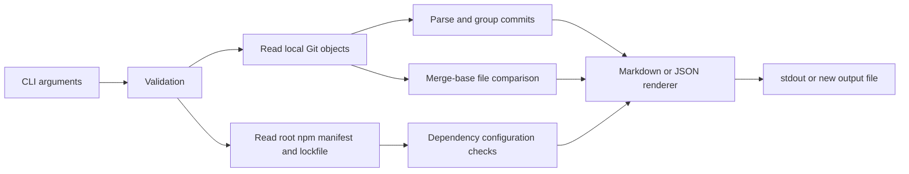

# RepoBrief

**离线生成变更日志、依赖配置报告和 PR 描述。** 无运行时 npm 依赖，无云端服务，无遥测。

**Offline changelogs, dependency configuration reports, and PR descriptions.**
Zero runtime npm dependencies. No cloud service, account, or telemetry required.

RepoBrief helps small open-source projects prepare a release or review a branch
using data already on disk. It does not claim to detect known vulnerabilities.

## 安装与快速开始 / Install and quickstart

Requirements: Node.js **22+**, npm, and Git on your PATH. The `deps` command also
works in directories that are not Git repositories. Use a current Git version.

Run these commands **from a downloaded or cloned RepoBrief source directory**:

```sh
npm ci --ignore-scripts
npm run build
node dist/cli.js --help
node dist/cli.js changelog --repo .
node dist/cli.js deps --repo . --format json
node dist/cli.js pr --repo . --base main
npm test
```

To install the command globally **from this source checkout**, after building:

```sh
npm install --global . --ignore-scripts
repobrief --version
repobrief changelog --repo /path/to/your/repository
```

On Windows, quote paths with spaces, for example `--repo "C:\Projects\My App"`.
The package name is `repobrief-cli`, and the command is `repobrief`.
No npm registry release is required by this quickstart.

## 用法 / Usage

```sh
# All reachable history, grouped by Conventional Commit type
repobrief changelog --repo .

# Exclusive start, inclusive selected tip; create a NEW report file
repobrief changelog --from v0.1.0 --to HEAD --output next-release.md

# Inspect root package.json and npm lockfile v2/v3, with an optional CI gate
repobrief deps --repo . --format json --fail-on high

# Compare the merge base of main and HEAD with HEAD, even if main has advanced
repobrief pr --base main --to HEAD --output pr-description.md
```

Flags must be separate arguments (`--format json`, not `--format=json`).
`--repo` defaults to the current directory; `--format` defaults to `markdown`.
`--to` defaults to `HEAD`; `pr --base` defaults to `main`.
History is limited to 1000 commits unless `--limit N` is set (maximum 10000).
An exceeded limit is an error, so a report never silently omits commits.
`--output` resolves from the invoking directory and refuses to replace any existing
file. Omit it to print to stdout. No automatic fetch, checkout, or commit occurs.

| Exit | Meaning |
| --- | --- |
| `0` | Report generated, no requested threshold crossed |
| `1` | Invalid input, unavailable Git history, or I/O failure |
| `2` | Dependency report generated and `--fail-on` threshold crossed |

`--fail-on warning` gates both warnings and high findings; `--fail-on high` gates
only high findings. Without this flag, findings do not change the successful exit.
JSON output has `schemaVersion: 1`, a `kind` discriminator, and deterministic order
for unchanged inputs. Reports do not include a wall-clock generation timestamp.

## 示例 / Example

For commits `feat(api)!: add JSON output` and `fix: handle paths with spaces`:

```markdown
# Changelog

Range: 1a2b3c4 → 5d6e7f8

## Features

- **api:** add JSON output (5d6e7f8) **BREAKING**

## Fixes

- handle paths with spaces (3a4b5c6)

## Breaking changes

- Consumers must read the new JSON schema (5d6e7f8)
```

This is an illustrative example; real reports escape untrusted Markdown content.
An executable sample project and generated outputs are in [examples](examples/).

## 依赖报告的边界 / Dependency report scope

| Check | Severity | Interpretation |
| --- | --- | --- |
| `INSTALL_SCRIPT` | High | Root lifecycle script or locked dependency install script |
| `INSECURE_SOURCE` | High | HTTP or unencrypted Git transport |
| `REMOTE_SOURCE` | High | Direct Git/URL source, or locked Git source |
| `UNPINNED_VERSION` | Warning | Direct dependency is not an exact version |
| `LOCAL_SOURCE` | Warning | Local path, link, or workspace reference |
| `MISSING_LOCKFILE` | Warning | Direct dependencies exist without an npm lockfile |
| `MISSING_INTEGRITY` | Warning | Locked HTTP(S) artifact lacks integrity metadata |
| `DUPLICATE_VERSIONS` | Warning | Multiple locked versions of a dependency |

These are review prompts. Workspaces, version ranges, lifecycle scripts and
duplicate versions can all be intentional. Peer ranges are excluded because
they describe compatibility. A missing finding is **not a security guarantee**.
RepoBrief does not query CVEs, verify artifact bytes, compare lock freshness,
analyze peer resolution, inspect licenses, or scan package source code.
It inspects only the root manifest and npm lockfile v2/v3; Yarn, pnpm, npm v1,
and recursive monorepo discovery are outside v0.1.

## 架构 / Architecture



`src/args.ts` validates command options; `git.ts` handles bounded, read-only Git
commands; `commits.ts` parses Conventional Commits; `dependencies.ts` checks npm
metadata; `safe.ts` escapes display content; `render.ts` formats reports; `io.ts`
bounds JSON input and protects existing files; `cli.ts` maps errors to exit codes.
Library exports are available from `dist/index.js` after building.

## 隐私与安全 / Privacy and security

- Runtime is offline. Git child processes disable lazy fetch and disallow every
  transport; shell execution, external diff, and text conversion are disabled.
- Only locally installed Git and Node.js built-ins run. Package scripts are never
  executed. Local Git configuration and the installed Git executable are trusted.
- Revision arguments resolve to commit IDs before diff/log use. Each Git operation
  has a 15-second timeout and 32 MiB output cap. JSON input is limited to regular
  files of at most 16 MiB and lockfiles to 100000 entries.
- Dependency source values and lifecycle command bodies are omitted from reports,
  so credentials in those fields are not copied. Commit text, project names and
  filenames may still be private; review output before sharing it.
- Development dependency installation uses the npm registry. `npm audit` queries
  npm advisory services. The separate publishing script contacts GitHub and waits
  for CI. These development/publishing operations require network access.

See [SECURITY.md](SECURITY.md) and [technical references](docs/references.md).

## 测试与贡献 / Tests and contributing

```sh
npm ci --ignore-scripts
npm test
npm run build
npm run check:security
npm run check:package
```

Tests use Node's built-in runner and temporary real Git repositories. The package
check installs the packed CLI offline and runs it through the installed command.
CI defines six jobs: Windows/Linux/macOS with Node.js 22/24. Remote CI results are
only confirmed after a successful GitHub run.

See [CONTRIBUTING.md](CONTRIBUTING.md), [AGENTS.md](AGENTS.md), and the
[90-day plan](docs/maintenance-plan.md). Bug reports should include versions,
the command, expected/actual results, and a small sanitized reproduction; feature
requests should describe the user's workflow. Issue forms are included.

## License

[MIT](LICENSE). Copyright (c) 2026 RepoBrief contributors.
